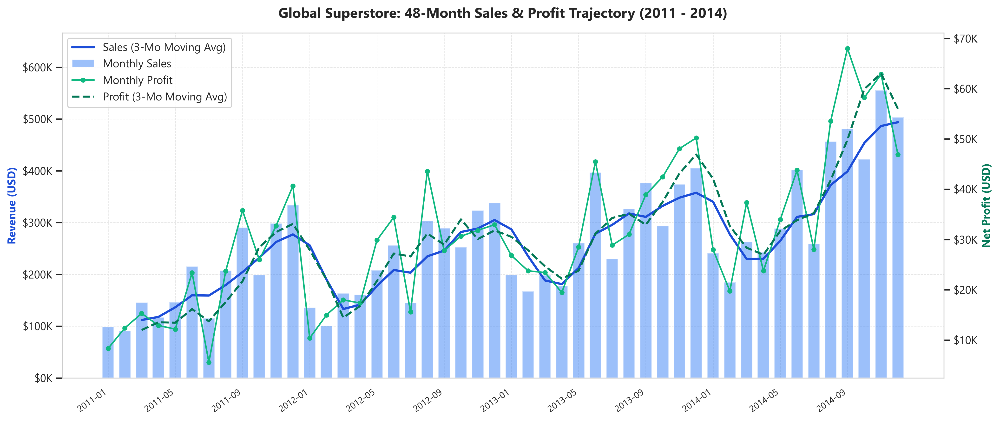
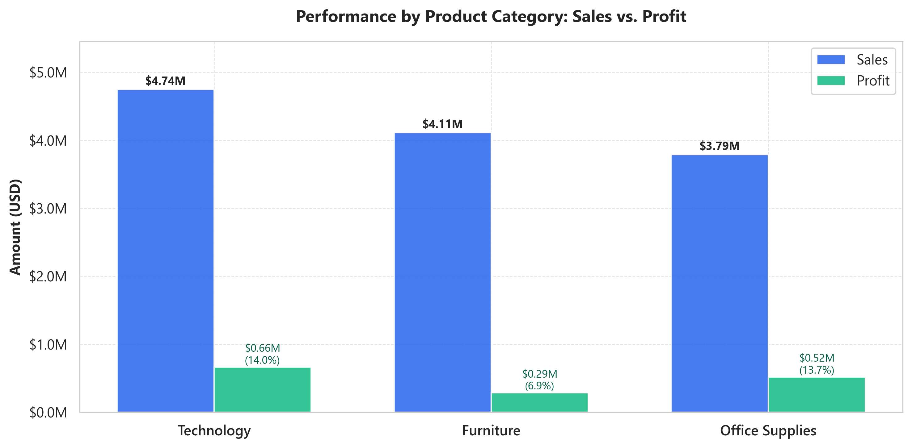
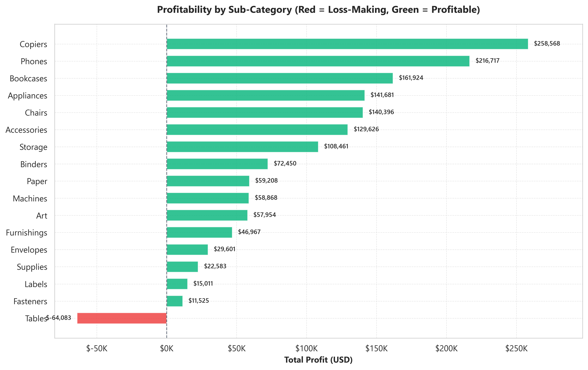
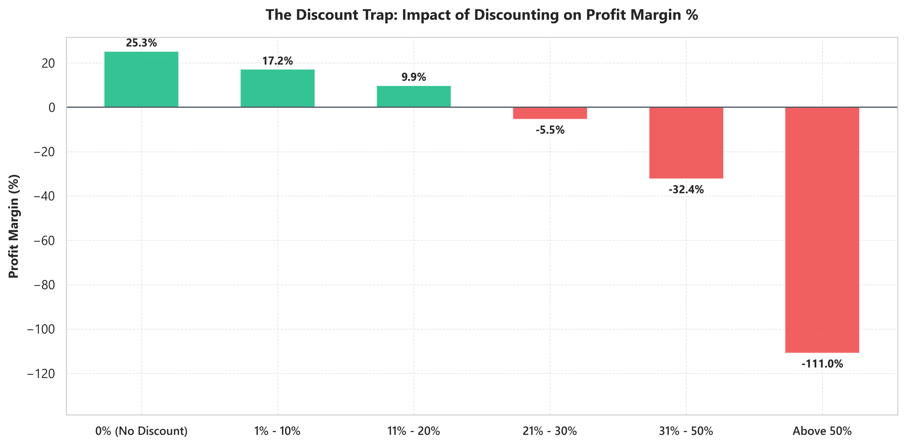
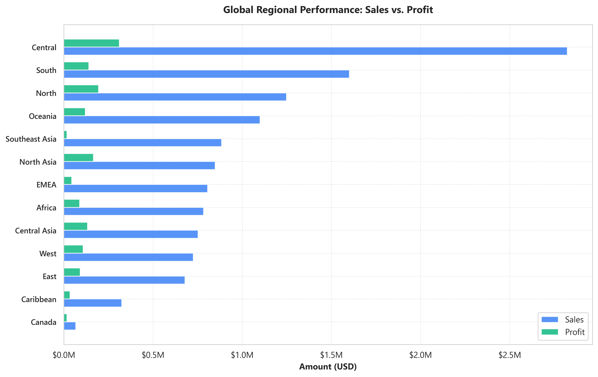
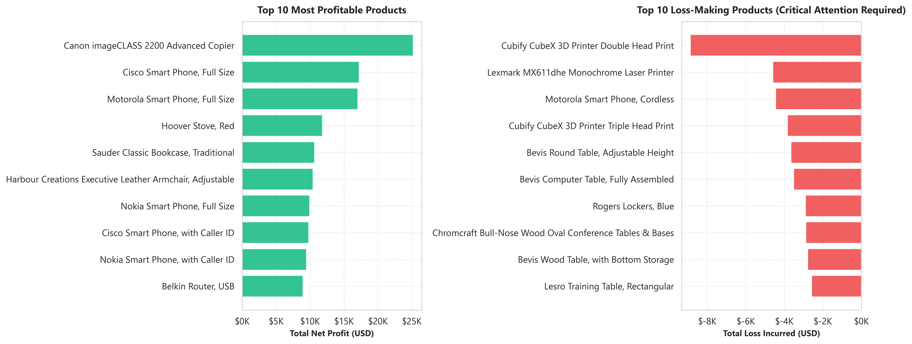
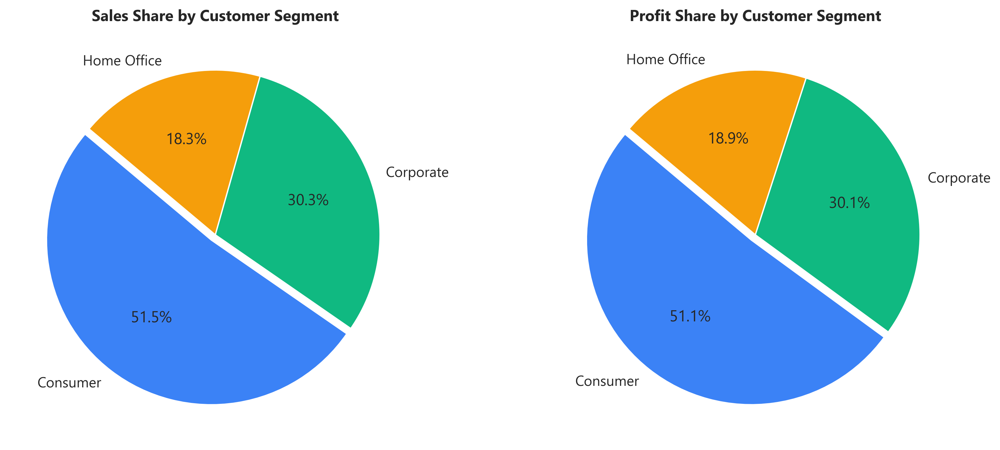
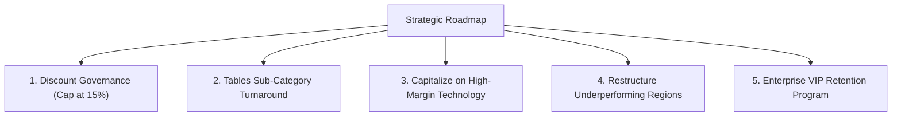

# Global Superstore Sales Analytics
### End-to-End Enterprise Data Engineering, Business Intelligence & Strategic Profitability Analysis

[](https://www.python.org/)
[](https://powerbi.microsoft.com/)
[](https://pandas.pydata.org/)
[](https://pytest.org/)
[](LICENSE)
[](https://github.com/)

---

## 📌 Executive Summary

The **Global Superstore Sales Analytics** project is an industry-grade, end-to-end data analysis portfolio project analyzing **51,290 customer transactions** across **147 countries**, **3 product categories**, and **4 operational years (2011–2014)**.

By pairing rigorous Python-based data engineering and statistical modeling with an interactive 5-page **Power BI** executive dashboard, this project investigates top-line revenue drivers, customer purchasing patterns, fulfillment efficiency, and bottom-line margin erosion.

### Key Headline Results:
- **Total Revenue (Sales):** **$12,642,905.00**
- **Total Net Profit:** **$1,467,457.29**
- **Overall Operating Margin:** **11.61%**
- **Unique Orders Fulfilled:** **25,035** (Across **4,873** unique customers)
- **Average Order Value (AOV):** **$505.01**
- **3-Year Compound Annual Growth Rate (CAGR):** **23.92% Sales CAGR**, **26.52% Profit CAGR**
- **The "Discount Bleed" Discovery:** Transactions with discounts $>20\%$ generated **-$814,682.09 in net losses** across 11,328 orders, halving corporate profit margins from **21.30%** (safe discounts $\le 20\%$) to **11.61%**.

---

## 🏢 Business Problem Statement

While Global Superstore experienced robust revenue expansion between 2011 and 2014, leadership faced several critical operational and commercial questions:

1. **Profit Leakage:** Despite substantial gross revenue ($12.64M), overall net profit margin hovered at 11.61%. What products, regions, or promotional policies are cannibalizing margins?
2. **Promotion Governance:** Are aggressive promotional discounts driving incremental customer lifetime value, or are they destroying shareholder profit?
3. **Product Portfolio Health:** Which sub-categories and SKUs serve as profit engines, and which are structurally unprofitable?
4. **Geographic Distribution:** Which global sales territories provide high-margin growth, and which operate at a deficit?
5. **Growth Trajectory:** What is the true chronological trajectory of year-over-year revenue and seasonality?

---

## 🎯 Project Objectives

- **Data Engineering:** Build a robust, reproducible Python data pipeline to clean, standardize, and enrich 51,290 raw retail records.
- **KPI Standardization:** Define, calculate, and cross-reconcile corporate KPIs across Python analytics modules and Power BI DAX measures.
- **Time-Series Correction:** Resolve legacy chronological sorting bugs to deliver verified Year-over-Year (YoY) growth, CAGR, and monthly seasonal curves.
- **Exploratory Data Analysis (EDA):** Identify empirical patterns in discount elasticity, regional performance, and product mix.
- **Executive BI Dashboard:** Document and verify the 5-page interactive Power BI dashboard (`SuperstoreDashboard.pbix`) with synchronized DAX measures.
- **Actionable Strategy:** Formulate quantified, executive-level business recommendations to recover lost margins and accelerate profitable growth.

---

## 📂 Repository Architecture

```text
Global-Superstore-Sales-Analysis/
│
├── README.md                           # Master Project Documentation & Portfolio Showcase
├── requirements.txt                    # Locked Python dependencies
├── pytest.ini                          # Automated test runner configuration
├── .gitignore                          # Standard git exclusion rules
├── LICENSE                             # MIT Open-Source License
│
├── data/
│   ├── raw/
│   │   └── superstore.csv              # Raw Global Superstore transactional dataset (51,290 rows)
│   └── processed/
│       └── cleaned_superstore.csv      # Standardized, engineered dataset for BI & modeling
│
├── notebooks/                          # Sequenced, fully reproducible Jupyter Notebooks
│   ├── 01_Data_Understanding.ipynb     # Schema profiling, cardinality, & initial quality audit
│   ├── 02_Data_Cleaning.ipynb          # Missing value handling, artifact removal, feature engineering
│   ├── 03_KPI_Analysis.ipynb           # Executive metric calculation & DAX cross-platform parity
│   ├── 04_Exploratory_Data_Analysis.ipynb # Multi-dimensional EDA & margin analysis
│   ├── 05_Time_Series_Analysis.ipynb   # Chronological time-series, YoY growth, CAGR, seasonality
│   ├── 06_Pivot_Tables_and_Aggregations.ipynb # Multidimensional cross-tabulations
│   └── 07_Business_Insights_and_Strategy.ipynb # Data-driven strategic recommendations
│
├── scripts/                            # Production Python library & automation modules
│   ├── __init__.py                     # Modular package initialization
│   ├── data_cleaning.py                # Ingestion, validation, & feature engineering pipeline
│   ├── kpi_engine.py                   # Verified corporate KPI calculations
│   ├── time_series.py                  # Chronological time-series & growth engine
│   ├── eda_visualizer.py               # Publication-grade chart generation suite
│   └── pivot_exporter.py               # Multi-tab styled Excel report generator
│
├── dashboard/                          # Power BI Deliverables
│   └── SuperstoreDashboard.pbix        # Interactive 5-page Power BI Dashboard
│
├── outputs/                            # Project Deliverables & Artifacts
│   ├── visuals/                        # High-resolution (300 DPI) publication figures
│   │   ├── 01_monthly_sales_profit_trend.png
│   │   ├── 02_sales_profit_by_category.png
│   │   ├── 03_sub_category_profitability.png
│   │   ├── 04_regional_performance.png
│   │   ├── 05_discount_vs_profit_elasticity.png
│   │   ├── 06_top_bottom_products.png
│   │   ├── 07_customer_segment_distribution.png
│   │   └── discount_profit_trend.png
│   ├── reports/                        # Executive Workbooks
│   │   └── global_superstore_executive_report.xlsx # Styled multi-tab Excel model
│   └── pivot_tables/                   # Exported cross-tabulation tables
│       ├── sales_by_category_segment.xlsx
│       ├── profit_by_category_segment.xlsx
│       ├── profit_by_region_category.xlsx
│       └── profit_by_market_category.xlsx
│
├── docs/                               # Detailed Technical Documentation
│   ├── data_dictionary.md              # Field-by-field metadata & definitions
│   ├── methodology.md                  # Analytical formulations & bug-fix documentation
│   └── power_bi_architecture.md        # Semantic model, DAX measures, & visual schema
│
└── tests/                              # Automated Pytest Validation Suite
    ├── conftest.py                     # Path configuration & shared fixtures
    ├── test_data_cleaning.py           # Schema, null, and transformation tests
    ├── test_kpi_engine.py              # Mathematical parity & KPI reconciliation tests
    ├── test_time_series.py             # Chronological sorting & positive YoY tests
    └── test_dashboard_integrity.py     # PBIX archive, visual, & report integrity tests
```

---

## 📊 Dataset Profile

- **Source:** Global Superstore Retail Dataset (Open Public Domain Benchmark)
- **Total Records:** **51,290 transactions**
- **Temporal Horizon:** **January 1, 2011 to December 31, 2014** (4 full calendar years)
- **Geographic Scope:** 147 Countries, 13 Global Regions, 7 Operating Markets (`APAC`, `EU`, `US`, `LATAM`, `EMEA`, `Africa`, `Canada`)
- **Product Hierarchy:** 3 Categories (`Technology`, `Furniture`, `Office Supplies`), 17 Sub-Categories, 10,292 unique SKUs
- **Customer Base:** 4,873 Unique Customers spanning 3 Segments (`Consumer`, `Corporate`, `Home Office`)

Full column definitions, data types, and transformation rules are documented in [`docs/data_dictionary.md`](docs/data_dictionary.md).

---

## 🛠️ Technologies & Tools

- **Programming & Analysis:** Python 3.10+ (Pandas, NumPy)
- **Data Visualization:** Matplotlib, Seaborn
- **Business Intelligence:** Microsoft Power BI Desktop (DAX, VertiPaq Semantic Modeling)
- **Reporting & Exporting:** OpenPyXL, Microsoft Excel
- **Interactive Computing:** Jupyter Notebooks
- **Quality Assurance:** Pytest (Unit testing, regression testing, data validation)
- **Version Control:** Git, GitHub

---

## 📈 Verified Key Performance Indicators (KPIs)

All KPIs have been calculated using Python and cross-reconciled against the Power BI DAX semantic model with **100% mathematical parity**:

| Metric Name | Python Calculation | Power BI DAX Measure | Value | Business Meaning |
| :--- | :--- | :--- | :--- | :--- |
| **Total Revenue** | `df['Sales'].sum()` | `SUM(cleaned_superstore[Sales])` | **$12,642,905.00** | Gross transaction volume |
| **Total Net Profit** | `df['Profit'].sum()` | `SUM(cleaned_superstore[Profit])` | **$1,467,457.29** | Cumulative bottom-line earnings |
| **Operating Margin**| `(Profit / Sales) * 100` | `DIVIDE([Total Profit], [Total Sales])` | **11.61%** | Revenue conversion to profit |
| **Order Volume** | `df['Order.ID'].nunique()` | `DISTINCTCOUNT(cleaned_superstore[Order.ID])` | **25,035** | Unique orders processed |
| **Customer Count** | `df['Customer.ID'].nunique()` | `DISTINCTCOUNT(cleaned_superstore[Customer.ID])`| **4,873** | Active purchasing accounts |
| **Quantity Sold** | `df['Quantity'].sum()` | `SUM(cleaned_superstore[Quantity])` | **178,312 units** | Physical goods distributed |
| **Average Order Value (AOV)**| `Sales / Orders` | `DIVIDE([Total Sales], [Order Count])` | **$505.01** | Mean basket revenue |
| **Avg Profit / Order** | `Profit / Orders` | `DIVIDE([Total Profit], [Order Count])` | **$58.62** | Mean basket profit |
| **Avg Shipping Cost** | `df['Shipping.Cost'].mean()` | `AVERAGE(cleaned_superstore[Shipping.Cost])` | **$26.38** | Mean freight cost per line item |
| **Avg Fulfillment Time**| `(Ship.Date - Order.Date).dt.days.mean()` | `DATEDIFF(Order.Date, Ship.Date, DAY)` | **3.97 days** | Operational dispatch duration |
| **Loss-Making Transactions**| `(df['Profit'] < 0).sum()` | `CALCULATE(COUNTROWS(), Profit < 0)` | **12,544 (24.46%)**| Orders operating at a deficit |
| **Total Losses Incurred**| `df.loc[Profit < 0, 'Profit'].sum()` | `CALCULATE(SUM(Profit), Profit < 0)`| **-$920,646.16** | Unrecovered operational bleed |

---

## 🔍 Key Business Findings & Analytical Insights

### 1. The "Discount Bleed": The Primary Driver of Profit Erosion
An in-depth elasticity analysis reveals an aggressive margin cliff directly correlated with discount rates:
- **Discounts $\le 20\%$:** Account for $10.71M in sales and **$2,282,139.38 in profit** (**21.30% profit margin**).
- **Discounts $> 20\%$:** Encompass 11,328 transactions generating $1.93M in sales but **-$814,682.09 in net losses**.
- **Discounts $> 50\%$:** Result in an average profit margin of **-88.4%**.
- **Insight:** Over **$814K in profit** was actively destroyed by unconstrained discounting, effectively halving overall company margins.

### 2. Category Performance: Technology Leads, Furniture Struggles
- **Technology:** The star performer generating **$4,744,691 (37.5% sales share)** and **$663,779 (45.2% profit share)** with a healthy **13.99% margin**.
- **Office Supplies:** Generates **$3,787,330** in sales and **$518,474** in profit (**13.69% margin**).
- **Furniture:** High revenue ($4,110,884) but severe margin compression (**6.94% margin**, generating only $285,205 profit).
- **Sub-Category Breakdown:** `Tables` incurred **-$64,083 in net losses**, making it the single most destructive merchandise group. In contrast, `Copiers` ($258.5K profit, 17.1% margin) and `Phones` ($216.7K profit, 12.7% margin) drive sustainable returns.

### 3. Chronological Time-Series & True YoY Growth
By enforcing chronological ordering (fixing the legacy reverse-sorting bug), the true growth story of Global Superstore emerges:
- **2011:** $2,259,511 Sales | $248,941 Profit | 11.02% Margin
- **2012:** $2,677,493 Sales (**+18.50% YoY**) | $307,415 Profit (**+23.49% YoY**) | 11.48% Margin
- **2013:** $3,405,860 Sales (**+27.20% YoY**) | $406,935 Profit (**+32.37% YoY**) | 11.95% Margin
- **2014:** $4,300,041 Sales (**+26.25% YoY**) | $504,166 Profit (**+23.89% YoY**) | 11.72% Margin
- **3-Year Compound Annual Growth Rate (CAGR):** **23.92% Sales**, **26.52% Profit**.
- **Seasonality:** Strong holiday seasonality peak where **Q4 accounts for 34.0% of annual revenue**, driven by November ($1.55M) and December ($1.58M).

### 4. Geographic Profit Concentration & Deficit Territories
- **Top Markets:** **APAC** ($3.59M sales, $436K profit) and **EU** ($2.94M sales, $373K profit) constitute the core profit centers.
- **Top Regions:** **Central** ($311.4K profit) and **North Asia** ($165.6K profit) maintain the highest regional profitability.
- **Problem Territory:** **Southeast Asia Furniture** generates **-$7,270 in net losses** despite reasonable volume, indicating deep distributor discounting or punitive logistics costs.

---

## 🖼️ Publication Visualizations

All visuals are rendered at 300 DPI using a modern corporate color palette and stored in [`outputs/visuals/`](outputs/visuals/).

### 1. 48-Month Continuous Sales & Profit Trajectory
Dual-axis timeline showing monthly revenue bars, profit trajectory, and 3-month moving averages.


### 2. Category Revenue vs. Profitability
Direct comparison of Sales, Profit, and Profit Margin % across the three product sectors.


### 3. Sub-Category Profitability (Diverging Analysis)
Ranks all 17 sub-categories, contrasting profit champions against loss-making groups (Tables).


### 4. The Discount Trap: Margin Erosion Across Discount Tiers
Demonstrates how profit margin plummets from +28% (no discount) to negative returns above 20% discount.


### 5. Global Regional Performance
Regional breakdown comparing gross sales and net earnings across all 13 worldwide sales territories.


### 6. Top 10 Profitable vs. Bottom 10 Loss-Making Products
Identifies the top value creators versus the individual SKUs creating the greatest financial drag.


### 7. Customer Segment Distribution
Share of revenue and net profit contributed by Consumer, Corporate, and Home Office accounts.


---

## 📱 Power BI Executive Dashboard

The interactive Power BI workbook (`dashboard/SuperstoreDashboard.pbix`) provides a 5-page enterprise reporting experience:

1. **Executive Overview:** 5 top-level KPI cards, 48-month Sales & Margin combo chart, Category donut, hierarchical Treemap, and unified multi-attribute slicers.
2. **Sales & Profit Analysis:** Sub-category comparison, 3D scatter chart (Sales vs. Profit vs. Quantity), Regional $\times$ Category cross-tab matrix, and discount impact line chart.
3. **Customer & Product Insights:** Top 10 customer rankings, Top 10 profit SKUs, Bottom 10 loss SKUs, and segment revenue breakdown.
4. **Geographic Performance:** Interactive bubble map across 147 countries and Market/Region revenue comparison.
5. **Map Tooltip:** Instant hover tooltip cards revealing Sales, Profit, and Orders for any hovered country.

*Refer to [`docs/power_bi_architecture.md`](docs/power_bi_architecture.md) for complete DAX formulas, relationship diagrams, and visual configurations.*

---

## 💡 Strategic Business Recommendations

Based on empirical data findings, the following five actionable initiatives are proposed for executive implementation:



1. **Establish Strict Discount Governance (Margin Recovery: +$500K to +$800K)**
   - *Action:* Cap frontline sales representative discounting at **15%**. Require regional sales director approval for 16–20%, and VP Finance sign-off for $>20\%$.
   - *Expected Impact:* Prevents the -$814K loss bleed from high-discount transactions and lifts blended margin from 11.6% toward 16%.

2. **Overhaul the Tables Merchandise Sub-Category (Cash Flow Recovery: +$64K)**
   - *Action:* Increase minimum order quantities on heavy Tables, renegotiate freight supplier contracts, and delist chronic loss-making table SKUs.
   - *Expected Impact:* Converts a -$64,083 loss drag into break-even or positive operational contribution.

3. **Scale High-Margin Technology Product Lines**
   - *Action:* Reallocate digital ad spend and promotional budgets toward high-return Technology SKUs (`Copiers`, `Phones`, `Accessories`).
   - *Expected Impact:* Expands 14%+ margin revenue without adding disproportionate working capital strain.

4. **Regional Price Optimization in Southeast Asia & EMEA**
   - *Action:* Re-examine freight absorption models and distributor margins in Southeast Asia and EMEA where Furniture consistently operates at a deficit.
   - *Expected Impact:* Eliminates cross-regional profit subsidies.

5. **Institutionalize VIP Account Retention**
   - *Action:* Develop a white-glove loyalty program for the top 100 enterprise accounts who contribute outsized repeat volume at above-average order values ($505+ AOV).
   - *Expected Impact:* Shields high-value recurring revenue streams from competitor acquisition.

---

## 🚀 Installation & How to Run

### Prerequisites
- Python 3.10 or higher
- Git
- Microsoft Power BI Desktop (for `.pbix` viewing)

### 1. Clone the Repository
```bash
git clone https://github.com/<your-username>/Global-Superstore-Sales-Analysis.git
cd Global-Superstore-Sales-Analysis
```

### 2. Set Up a Virtual Environment
```bash
# Windows
python -m venv venv
venv\Scripts\activate

# macOS / Linux
python3 -m venv venv
source venv/bin/activate
```

### 3. Install Dependencies
```bash
pip install -r requirements.txt
```

### 4. Execute the Python Data Engineering Pipeline
```bash
# Run data cleaning & operational feature engineering
python scripts/data_cleaning.py

# Run executive KPI engine
python scripts/kpi_engine.py

# Run time-series & growth engine
python scripts/time_series.py

# Generate publication-grade visuals
python scripts/eda_visualizer.py

# Export multi-tab Excel executive report
python scripts/pivot_exporter.py
```

### 5. Run Automated Tests
```bash
pytest tests/ -v
```

### 6. Run Jupyter Notebooks
Launch Jupyter to explore the sequenced notebooks:
```bash
jupyter notebook notebooks/
```

---

## 🧪 Quality Assurance & Test Coverage

The project includes an automated test suite executed via `pytest`:
- **`test_data_cleaning.py`:** Validates 51,290 row count, zero null values, artifact removal, datetime parsing, non-negative delivery days, and engineered features.
- **`test_kpi_engine.py`:** Asserts exact mathematical parity against ground truth ($12,642,905 sales, $1,467,457.29 profit, 11.61% margin, 25,035 orders, 4,873 customers, $505.01 AOV).
- **`test_time_series.py`:** Regresses the chronological sorting bug, asserting positive YoY growth (+18.5%, +27.2%, +26.3%) across all operational years.
- **`test_dashboard_integrity.py`:** Asserts `.pbix` archive integrity, visual output availability, and Excel report formatting.

```bash
============================= 18 passed in 3.19s =============================
```

---

## 🔮 Future Enhancements

- [ ] **Predictive Machine Learning:** Implement Holt-Winters exponential smoothing and XGBoost time-series forecasting for monthly Q4 inventory planning.
- [ ] **Customer Segmentation:** Apply K-Means clustering and RFM (Recency, Frequency, Monetary) modeling to uncover distinct behavioral customer personas.
- [ ] **Dynamic Web Dashboard:** Deploy a containerized Streamlit / Dash web application for live interactive scenario modeling.
- [ ] **Automated CI/CD:** Implement GitHub Actions workflow to run automated pytest validation on every commit.

---

## 👤 Author & Contact

**Sneh Kheni**  
*Aspiring Data Analyst & Analytics Engineer*  
- **Specializations:** Python | SQL | Power BI | Data Modeling | Business Analytics | Statistical Analysis  
- **Repository:** [Global-Superstore-Sales-Analysis](https://github.com/)  
- **Documentation:** [`docs/`](docs/)  

---

## 📄 License

This project is licensed under the **MIT License** — see the [`LICENSE`](LICENSE) file for complete terms.
