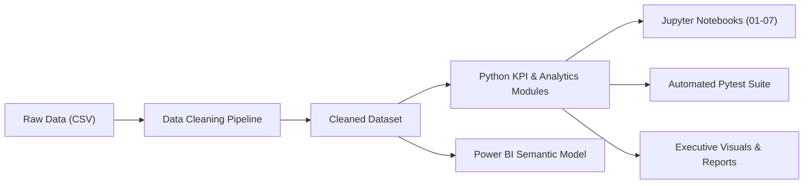

# Global Superstore Analytics Methodology

This document outlines the engineering and analytical principles applied throughout the audit, transformation, analysis, and verification of the Global Superstore repository.

---

## 1. Data Architecture & Pipeline



### Data Pipeline Principles
1. **Schema Preservation for BI Integration:** The Power BI dashboard (`SuperstoreDashboard.pbix`) relies on exact column identifiers (`Customer.Name`, `Product.Name`, `Category`, `Sub.Category`, `Region`, `Market`, `Country`, `Year`, `Discount`, `Sales`, `Profit`, `Quantity`, `Order.ID`, `Order.Date`). The cleaning pipeline guarantees 100% backward compatibility.
2. **Artifact Elimination:** Non-informative artifact columns (`记录数`) are eliminated at the ingestion layer.
3. **Operational Feature Enrichment:** Deriving `Shipping_Days`, `Unit_Price`, `Profit_Margin_Pct`, and `Discount_Band` directly inside the cleaned dataset enables uniform downstream logic across notebooks, scripts, and tests.

---

## 2. Mathematical Formulations & KPI Definitions

| Metric | Business Definition | Mathematical Formula | Power BI DAX Expression |
| :--- | :--- | :--- | :--- |
| **Total Revenue** | Aggregate gross sales across all transactions | $\sum \text{Sales}$ | `SUM(cleaned_superstore[Sales])` |
| **Total Net Profit** | Aggregate bottom-line earnings | $\sum \text{Profit}$ | `SUM(cleaned_superstore[Profit])` |
| **Profit Margin %** | Share of gross revenue converted to profit | $\frac{\text{Total Profit}}{\text{Total Sales}} \times 100$ | `DIVIDE([Total Profit], [Total Sales])` |
| **Order Volume** | Total distinct customer orders fulfilled | $\text{CountDistinct}(\text{Order.ID})$ | `DISTINCTCOUNT(cleaned_superstore[Order.ID])` |
| **Customer Base** | Total unique purchasing accounts | $\text{CountDistinct}(\text{Customer.ID})$ | `DISTINCTCOUNT(cleaned_superstore[Customer.ID])` |
| **Average Order Value (AOV)** | Average revenue per unique order | $\frac{\text{Total Sales}}{\text{Total Orders}}$ | `DIVIDE([Total Sales], [Order Count])` |
| **Quantity Sold** | Total physical units transacted | $\sum \text{Quantity}$ | `SUM(cleaned_superstore[Quantity])` |
| **Fulfillment Duration** | Days elapsed between order placement and dispatch | $\text{Ship.Date} - \text{Order.Date}$ | `DATEDIFF(Order.Date, Ship.Date, DAY)` |
| **YoY Sales Growth** | Annual revenue expansion rate | $\frac{\text{Sales}_t - \text{Sales}_{t-1}}{\text{Sales}_{t-1}} \times 100$ | Time Intelligence DAX |
| **3-Year CAGR** | Geometric annualized revenue growth rate | $\left(\frac{\text{Sales}_{2014}}{\text{Sales}_{2011}}\right)^{1/3} - 1$ | Custom Metric |

---

## 3. Critical Bug Fix: Time Series Growth Direction

### The Issue
In legacy versions of `Time_Series_Analysis.ipynb`, yearly sales were grouped and sorted descending by sales volume before calculating percentage change:
```python
# DEFECTIVE LEGACY IMPLEMENTATION
yearly_sales = df.groupby("Year")["Sales"].sum().sort_values(ascending=False)
sales_growth = yearly_sales.pct_change() * 100
```
Because 2014 had the highest revenue, the index evaluated from 2014 downwards to 2011, yielding:
- 2014: `NaN`
- 2013 vs 2014: **-20.79%** (Negative growth)
- 2012 vs 2013: **-21.38%** (Negative growth)
- 2011 vs 2012: **-15.61%** (Negative growth)

### The Fix
The time-series module (`scripts/time_series.py`) and notebook `05_Time_Series_Analysis.ipynb` enforce strict chronological sorting:
```python
# VERIFIED CORRECT IMPLEMENTATION
yearly_sales = df.groupby("Year")["Sales"].sum().sort_index(ascending=True)
sales_growth = yearly_sales.pct_change() * 100
```
This reveals the true positive growth trajectory:
- 2011: $2,259,511 (Baseline)
- 2012: $2,677,493 (**+18.50% YoY**)
- 2013: $3,405,860 (**+27.20% YoY**)
- 2014: $4,300,041 (**+26.25% YoY**)
- **3-Year Sales CAGR:** **23.92%**

---

## 4. Quality Assurance & Automated Testing Standards

The repository enforces automated verification via `pytest`:
- `tests/test_data_cleaning.py`: Validates input dimensions (51,290 rows), zero nulls, non-negative delivery days, and feature presence.
- `tests/test_kpi_engine.py`: Asserts exact mathematical parity with ground-truth corporate metrics ($12.64M sales, $1.47M profit, 11.61% margin).
- `tests/test_time_series.py`: Prevents regression of the time-series chronological sorting bug and asserts positive YoY growth across all operating years.
- `tests/test_dashboard_integrity.py`: Confirms `.pbix` archive integrity, visual outputs, and multi-sheet Excel reports.
